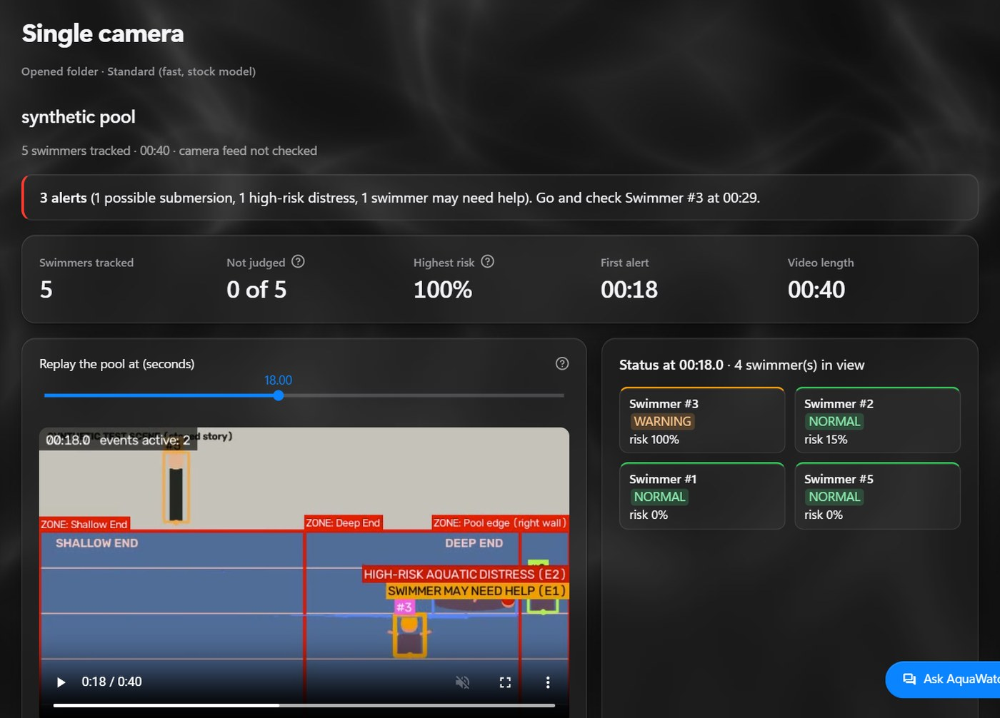
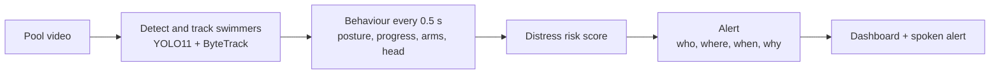
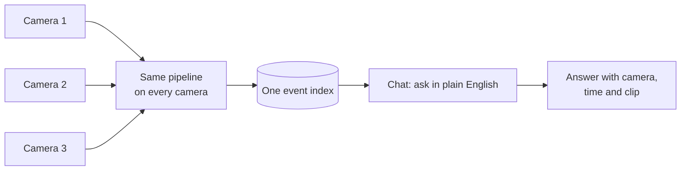
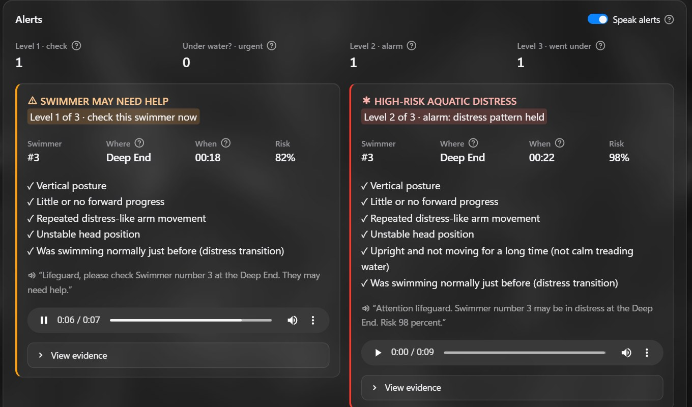

# AquaWatch

**Drowning early warning for swimming-pool CCTV.** AquaWatch watches every swimmer, spots distress behaviour and
alerts the lifeguard: who, where, when and why.



> **Research prototype.** An extra pair of eyes for lifeguards, never a replacement. On our labelled test videos it
> caught 2 of 6 victims and raised 13 false alerts.

## What it does

- **Tracks** every swimmer in the video.
- **Reads behaviour** twice a second: posture, forward progress, arm movement, head position.
- **Scores distress** and raises spoken alerts in 3 levels.
- **Joins several cameras** on one timeline.
- **Answers questions** in plain English, with the camera, the time and a video clip as proof.
- **Runs on a laptop CPU**, offline, using 2 threads.

## How it works



| Level | Alert | When |
|---|---|---|
| 1 | Swimmer may need help | risk stays at warning level (0.55) |
| 2 | High-risk distress | risk 0.7 or more for 5 s |
| 3 | Possible submersion | a swimmer in distress disappears |



## Screenshots

| Alerts with evidence | Chat with proof |
|---|---|
|  |  |


The single-camera screens show our drawn test scene (no real people).

## Quick start

Python 3.11 on Windows, macOS or Linux.

```bash
git clone https://github.com/Lokeshraj2006/HexTech-AquaWatch.git
cd HexTech-AquaWatch
pip install -r requirements.txt
python aquawatch/get_models.py
streamlit run app.py
```

- `get_models.py` downloads the models once (about 57 MB) from this repo's release and checks them.
- Add `--with-chat-model` for the optional chat model (about 338 MB, smarter questions and picture search).
- Open http://localhost:8501. On Windows you can also double-click `start_aquawatch.bat`.
- No videos are included. Put your own pool clips in `samples/` or upload one on the page.

**Command line:**

```bash
python aquawatch/run.py --video samples/your_clip.mp4 --scenario pool_trained   # close or medium shot
python aquawatch/run.py --video samples/your_clip.mp4 --scenario pool_hd        # wide, crowded CCTV
```

## Detectors

| Preset | Model | Best for |
|---|---|---|
| `pool_trained` | our YOLO11n, trained on pool images | close and medium shots |
| `pool_hd` | stock YOLO11s at 960 px | wide, crowded CCTV (slower) |
| `pool` | stock YOLO11n | quick checks and drawn test clips |

## Honest status

- The rules work on our drawn test scene with ground truth (every alert right, no false ones).
- On real footage: 2 of 6 labelled victims caught, 13 false alerts. Detector accuracy on real CCTV is not measured yet.
- The multi-camera demo is 4 crops of one recording, not 4 real cameras.
- No login: the dashboard opens on your own computer only.

## Folders

```
app.py          the dashboard
config.yaml     every threshold
aquawatch/      all the code
data/           test questions, rule records, an example result
training/       train your own swimmer model (Colab)
images/         README pictures
```

Train your own swimmer model: [training/README.md](training/README.md).

## Licence

- **AGPL-3.0** ([LICENSE](LICENSE)), because AquaWatch is built on Ultralytics YOLO (AGPL-3.0).
- Packages, models and dataset credits: [THIRD_PARTY_NOTICES.md](THIRD_PARTY_NOTICES.md).
