# AquaWatch

**An early-warning assistant that watches pool CCTV, reads how every swimmer behaves, and alerts the lifeguard
before a swimmer in trouble goes unnoticed.**

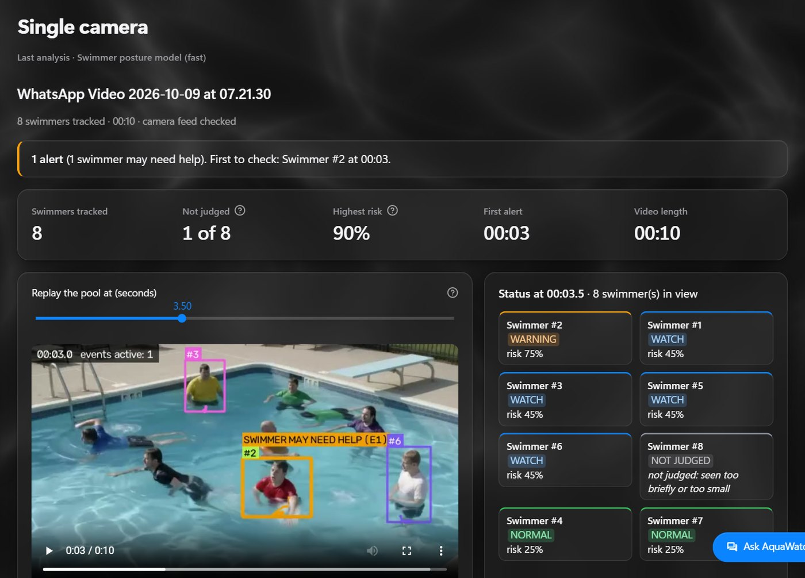

> Research prototype. An extra pair of eyes for lifeguards, never a replacement.

---

## 1. The idea

**The problem.** Drowning is usually silent. A swimmer in trouble rarely shouts or waves: they stay upright, make no
forward progress, press their arms down and their head sinks low. In a crowded pool a lifeguard can miss this for the
few seconds that matter. Most pools already have CCTV, but nobody can watch every screen all the time.

**Our solution.** AquaWatch turns that existing CCTV into a second pair of eyes:

- It follows **every swimmer** in the video, all the time.
- It judges **behaviour over time**, not a single frame, so normal swimming, resting and treading water are not
  mistaken for distress.
- It raises an **explained alert**: who, where, when, why, with a picture, a chart and a spoken message.
- It joins **several cameras** on one timeline.
- Staff can **ask questions in plain English** ("Who is drowning?") and get answers backed by the camera, the time and
  a video clip.
- It runs on an **ordinary laptop CPU, offline**. No cloud, no GPU, and faces are never searched.

**What makes it different:** explainable behaviour rules instead of a black box, answers that come only from the
analysis (no AI guessing), and a design that fits cheap hardware a real pool already has.

## 2. Scope

| | |
|---|---|
| **Users** | Lifeguards, pool managers and safety staff; researchers in water safety |
| **Input** | Recorded pool videos (sample, upload or laptop webcam); one camera or a site of several cameras |
| **Output** | Alerts, a swimmer status board, an annotated replay, reports, a multi-camera timeline and a chat |
| **Not in scope** | Live camera streams, face recognition, a certified safety device |

## 3. System overview

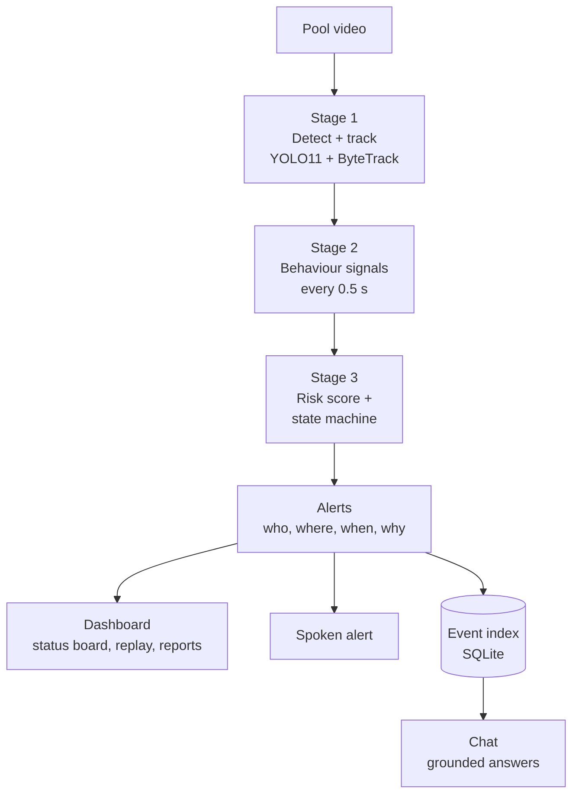

For several cameras, the same pipeline runs on every camera and all events go into one index:

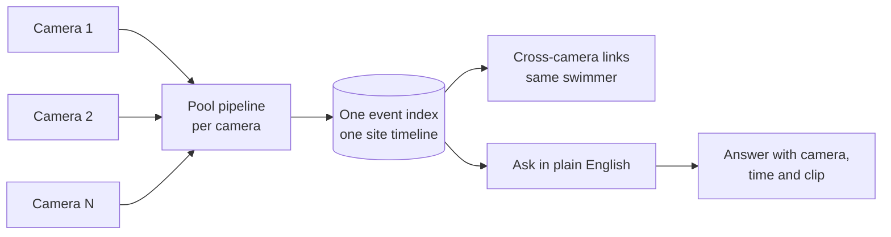

## 4. Functional requirements

| ID | Requirement | How AquaWatch meets it |
|---|---|---|
| FR-1 | Take a pool video | Sample, upload or webcam recording; optional pool zones (deep end, shallow end, wall) |
| FR-2 | Find and follow every swimmer | YOLO11 detector + ByteTrack tracker; broken tracks are re-joined |
| FR-3 | Describe behaviour | Posture, progress, arms and head every 0.5 s (section 5) |
| FR-4 | Score distress | Weighted risk score and a per-swimmer state machine (section 5) |
| FR-5 | Alert with evidence | 3 alert levels + urgent "possibly under water", each with reasons, snapshot, chart and voice |
| FR-6 | Show every swimmer's state | Status board synced to a replay slider: normal, watch, warning, not judged |
| FR-7 | Keep a record | HTML report, summary, highlight reel, timeline, heatmap, JSON files, run log |
| FR-8 | Handle several cameras | Camera registry, one site timeline, same swimmer linked across cameras |
| FR-9 | Answer questions | Plain-English chat; every answer cites camera, time and evidence |
| FR-10 | Learn place names | Asks once which camera "the deep end" is, then remembers it |
| FR-11 | Find described things (open vocabulary) | "Is there a child in a blue life jacket?" via CLIP search, checked by the YOLOE or YOLO-World detector (section 6.3) |
| FR-12 | Check the camera feed | Flags a video that ends early, freezes, has gaps or is too dark |
| FR-13 | Protect privacy | Runs locally; faces, gender, age never searched; optional face blur |

## 5. Behavioural analysis

### 5.1 Behaviour signals (stage 2)

Every **0.5 s**, for every tracked swimmer, AquaWatch looks at the last **2 s** and measures:

| Signal | What it means | Measured from |
|---|---|---|
| **Posture** | horizontal (swimming) / vertical (upright) / head only / underwater | our trained detector's class, else the torso angle from pose keypoints, else the box shape |
| **Forward progress** | net distance travelled per second, and progress ratio (straight line vs going nowhere) | box centre over time |
| **Arm movement** | repeated (distress-like) / stroking (swimming) / calm | wrist peaks per second from pose keypoints (6 per second) |
| **Head** | stable / unstable / submerged | head visibility and bobbing; head height above the shoulders |
| **Transition** | was this swimmer swimming normally just before? | the last 30 s of the same track |
| **Stationary** | upright and not moving for 4 s or more | posture + progress |

All distances are measured in **body heights**, so the same rules work near and far from the camera. A new posture
must last 1 s before it counts (no flicker), and a track that jumps (possible ID switch) is ignored.

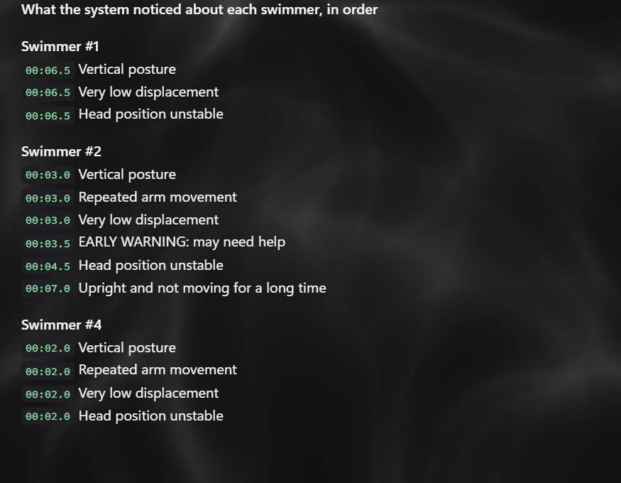

### 5.2 Distress scoring (stage 3)

Each sample gets a **risk score** = the sum of the warning signs present (max 1.0):

| Warning sign | Weight |
|---|---|
| Vertical posture | 0.25 |
| Little or no forward progress | 0.25 |
| Repeated distress-like arm movement | 0.25 |
| Unstable head | 0.15 |
| Upright and still for a long time | 0.15 |
| Was swimming normally just before | 0.10 |

**Look-alikes are damped,** so normal pool life does not raise alarms:

- Resting at the wall with calm arms: risk × 0.3.
- Treading water (upright, calm arms, steady head): risk capped at 0.45.
- Standing still in the shallow end or on the steps is normal.
- People outside the water zone are ignored.

A **state machine** per swimmer turns the risk curve into states:

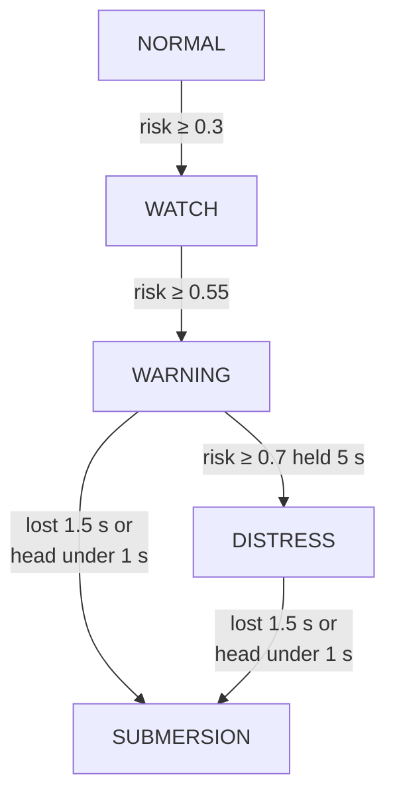

### 5.3 Alerts

| Level | Alert | Raised when |
|---|---|---|
| 1 | **Swimmer may need help** | risk at warning level (0.55) in at least half of the last 5 s |
| Urgent | **Possibly under water** | a swimmer vanishes in open water, the spot stays empty for 5 s, and someone appears at the same spot within 20 s |
| 2 | **High-risk aquatic distress** | risk 0.7 or more, held for 5 s |
| 3 | **Possible submersion** | a swimmer in warning or distress disappears, or the head stays under |

Every alert says **who** (swimmer number), **where** (camera, zone, part of the picture), **when**, and **why** (the
signs it saw). It has a confidence = 0.4 × margin past the threshold + 0.3 × duration + 0.3 × detection confidence,
an evidence snapshot, a risk chart, and a **spoken message** ("Lifeguard, please check Swimmer number 2 ...").

| Alert card | Why it was flagged |
|---|---|
| 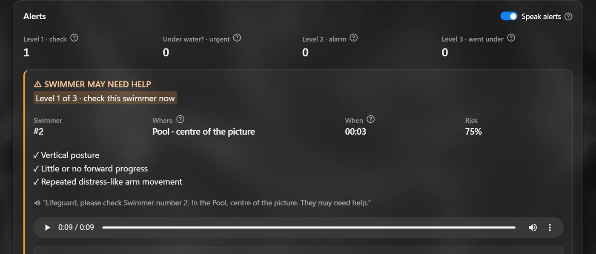 | 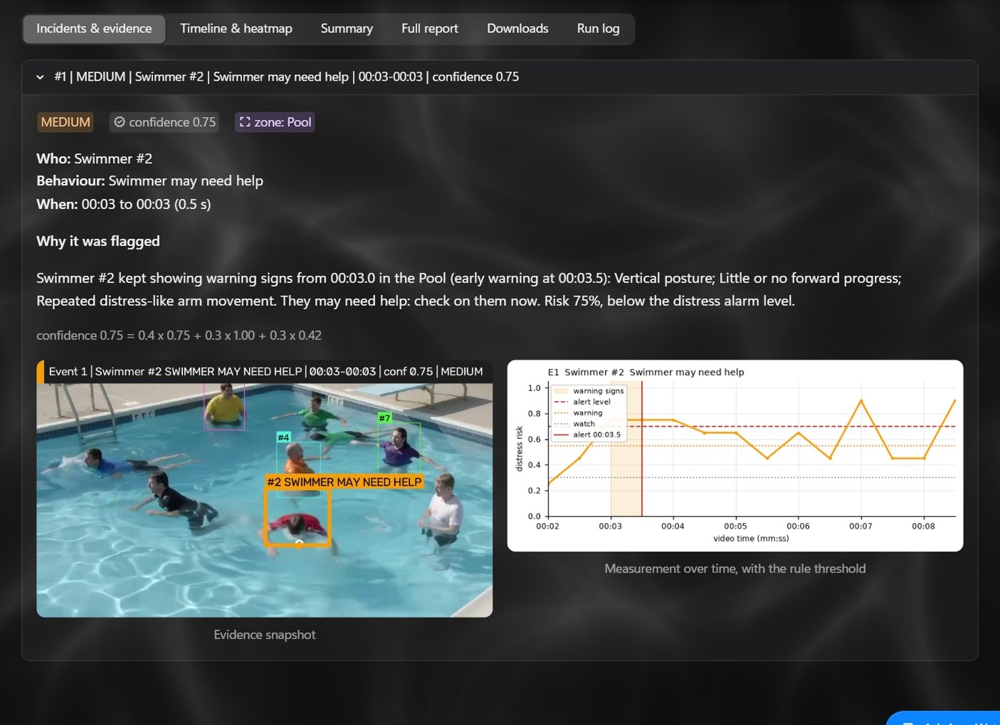 |

## 6. Multi-camera site, chat and open-vocabulary search

### 6.1 Multi-camera site

A camera registry lists each camera's name, video, start time and zones. AquaWatch runs the
pipeline on every camera and writes all events into one SQLite index with video time and clock time. The site page
shows every camera, the swimmers in view, a risk timeline per camera and all events in one table. The same swimmer is
linked across overlapping cameras from known camera geometry; colour-based look-alike matches are only offered as
"unverified". Our demo site is **4 views cut from one recording**, not 4 physical cameras.

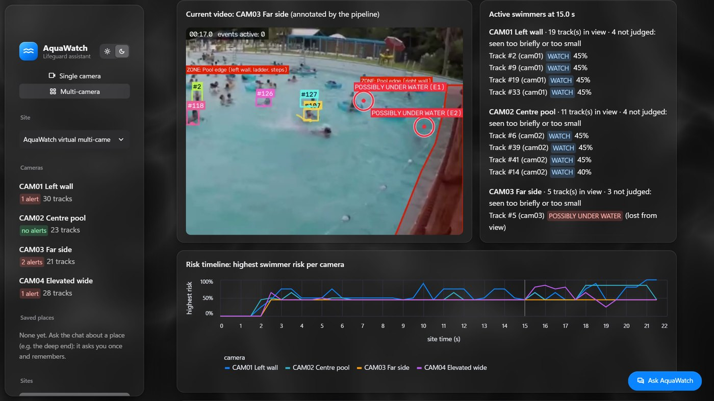

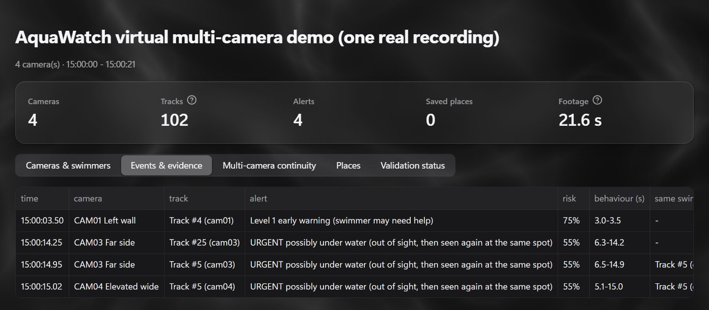

### 6.2 Chat ("Ask AquaWatch")

A drawer on every page:

- **Grounded answers:** what happened, who may be in trouble, the highest risk, who was in view at a time, the
  evidence for an alert. Answers are built only from the analysis files, never invented, and cite camera, time,
  track and a clip.
- **Question routing:** a CLIP text encoder matches the question to the right kind of answer (no chatbot model).
- **Clarify once:** an unknown place ("the deep end") is asked about once, saved, and remembered after a restart.
- **Description search:** open-vocabulary search (section 6.3); "Check with YOLOE" can confirm with a box or
  say "no confident match".
- **Privacy:** questions about faces, race, skin colour, gender or age are always refused.

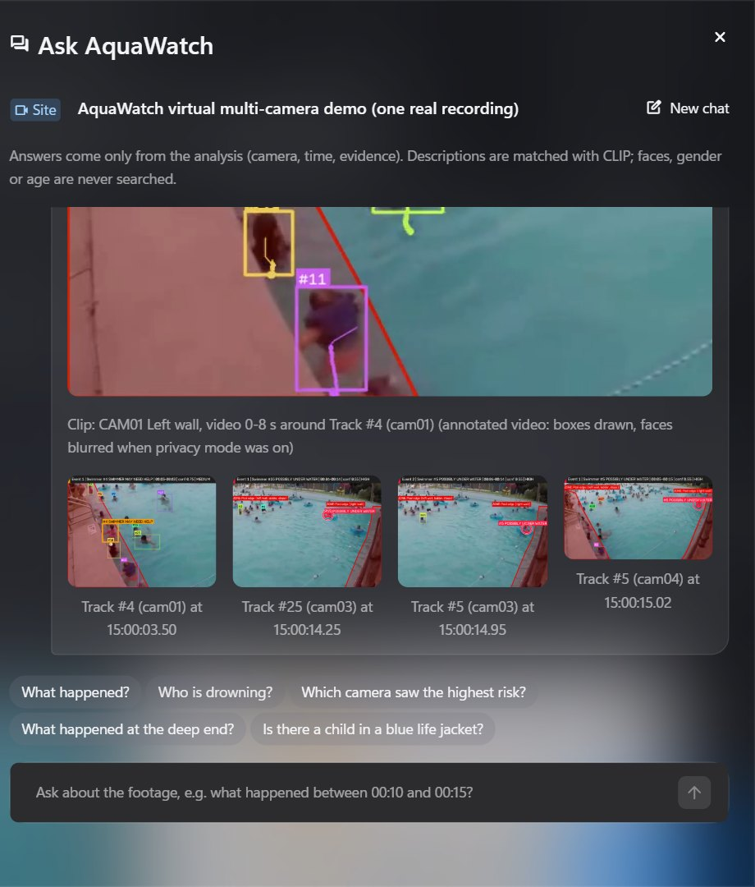

### 6.3 Open-vocabulary search (CLIP, YOLOE, YOLO-World)

A normal detector only knows its fixed classes (here: a person or a swimmer posture). **Open vocabulary** means you
can search for anything you can describe in words, even things no model was trained on: "a child in a blue life
jacket", "a lifeguard jumping into the pool", "a swimmer holding a float".

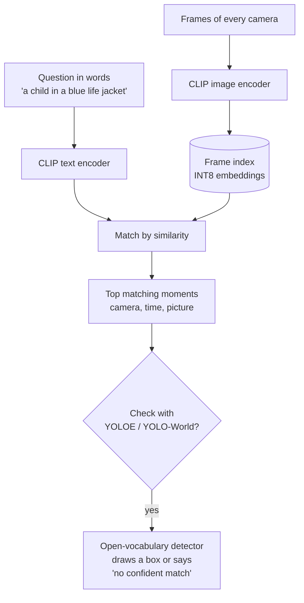

| Method | What it does | Strength | Weakness |
|---|---|---|---|
| **CLIP frame ranking** (OpenAI CLIP ViT-B/32) | turns every frame and the question into vectors and ranks frames by similarity | fast (~0.2 s per question), finds the right moment most often | cannot say "not there": it always returns its best guess |
| **YOLOE** (open-vocabulary detector) | takes CLIP's top frames and looks for the described object, drawing a box | can say "not there", shows exactly where | slower (~9 s per question), misses small, far-away objects |
| **YOLO-World** (open-vocabulary detector) | same idea as YOLOE, a different model | can say "not there" | found fewer right moments than YOLOE |

Measured on 19 "is it there?" questions and 9 "not there" questions (one test clip, a sanity check rather than a
benchmark), with the rules fixed before measuring:

| Method | Right moment first | In the top 5 | "Not there" rejected | Time per question |
|---|---|---|---|---|
| **CLIP frame ranking (used by the chat)** | **12/19** | **18/19** | 0/9 | ~0.21 s |
| YOLOE (retrieve, then detect) | 6/19 | 9/19 | **9/9** | ~9.3 s |
| YOLO-World (retrieve, then detect) | 3/19 | 5/19 | **9/9** | ~8.7 s |

- So the chat uses **CLIP ranking** by default, and **"Check with YOLOE"** is a button for a second opinion that can
  confirm with a box or reject. YOLOE beat YOLO-World, so YOLOE is the one offered.
- Both detectors run as **OpenVINO FP32** exports (1.4× faster, identical results; section 8). OpenAI CLIP was chosen
  partly because YOLO-World needs the same CLIP model, so one model file serves both.
- The frame index stores **INT8 embeddings** (588 KB for the demo site) with the same accuracy as FP16.
- Searching by face, race, skin colour, gender or age is always refused.

## 7. Non-functional requirements

| Area | Requirement |
|---|---|
| **Hardware** | Runs on a laptop CPU, no GPU needed |
| **Laptop stays usable** | 2 CPU threads and below-normal priority for every analysis (change with `AQUAWATCH_THREADS`) |
| **Speed** | Detector time per frame on a laptop CPU: 109 ms (swimmer model), 114.5 ms (standard), 729 ms (wide CCTV) |
| **Offline** | After setup no internet is needed; no usage analytics or telemetry |
| **Privacy** | Dashboard opens on this computer only; faces never searched; optional face blur on every output |
| **Explainability** | Every alert shows its signs, numbers, snapshot and chart |
| **Reliability** | Optional steps (pose, rendering) never crash a run; the camera feed is checked on every run |
| **Portability** | Windows, macOS and Linux; Python 3.11 |
| **Configurable** | Every threshold lives in `config.yaml` |

## 8. Quantization and speed-up

The laptop has no GPU, so we made the models faster on a CPU, but only if the boxes stay **exactly as good**. We
fixed the rule before measuring: a converted model is accepted only if its boxes match the original PyTorch FP32
model with **F1 ≥ 0.98** on 100 frames.

| Detector | PyTorch FP32 | **OpenVINO FP32 (used)** | OpenVINO INT8 | ONNX INT8 |
|---|---|---|---|---|
| YOLO11n @ 640 | 176 ms | **114.5 ms, F1 1.000 (1.54× faster)** | 78 ms, F1 0.927 | 194 ms, F1 0.732 |
| YOLO11s @ 960 | 975 ms | **729 ms, F1 1.000 (1.34× faster)** | 468 ms, F1 0.917 | 1101 ms, F1 0.800 |
| Our swimmer model @ 640 | 161 ms | **109 ms, F1 1.000 (1.48× faster)** | 75 ms, F1 0.931 | 188 ms, F1 0.848 |

- **Used: OpenVINO FP32 exports** of all three detectors: identical boxes, 1.3-1.5× faster.
- **Rejected: INT8** (NNCF and ONNX Runtime post-training quantization). It was up to 2× faster and 3× smaller, but
  it changed 7-8 % of the boxes. This CPU has no VNNI instructions, so INT8 gains less here than on newer CPUs.
- **YOLOE / YOLO-World** (chat's "Check with YOLOE"): OpenVINO FP32 exports, 1.4× faster with identical results;
  INT8 failed.
- **CLIP search:** the frame index stores **INT8 embeddings** (half the size of FP16, index 588 KB) with the same
  accuracy. Quantizing CLIP's own weights to INT8 was rejected: it reordered the search results too much.
- The OpenVINO and ONNX runtimes are capped to the same 2 threads, so the laptop stays usable.

## 9. Tech stack

| Layer | Technology | Used for |
|---|---|---|
| Language | **Python 3.11** | everything |
| Detection | **Ultralytics YOLO11** (YOLO11n, YOLO11s) | finding swimmers |
| Custom model | **YOLO11n fine-tuned** on 13,081 pool images, 5 classes | swimmer posture: horizontal, vertical, head only, underwater, out of water |
| Pose | **YOLO11n-pose** | wrists, shoulders, head for arm and head signals |
| Tracking | **ByteTrack** (Ultralytics, `lap`) + our track stitching | one ID per swimmer over time |
| Speed-up | **OpenVINO** FP32 IR; NNCF, ONNX Runtime (INT8 trials); **PyTorch** CPU | fast CPU inference (section 8) |
| Vision-language | **OpenAI CLIP ViT-B/32** via `open_clip` | question routing, description search |
| Open-vocabulary detection | **YOLOE**, **YOLO-World** | confirming a described object |
| Video and images | **OpenCV**, **NumPy**, **Pillow**, FFmpeg (optional, H.264) | reading frames, drawing, annotated video |
| Charts | **Matplotlib** | risk charts, timeline, heatmap |
| Storage | **SQLite**, JSON / JSONL, **YAML** | event index, saved places, results, settings |
| Dashboard | **Streamlit 1.65** + custom CSS (light and dark glass theme) | the web interface |
| Speech | System voices: Windows System.Speech, macOS `say`, Linux `espeak` | offline spoken alerts |
| Training | **Roboflow Universe** datasets (CC BY 4.0), **Google Colab** T4 GPU | training the swimmer model |
| Testing | **pytest**, Streamlit AppTest | automated tests (local suite) |

## 10. Results (honest)

| What | Result |
|---|---|
| Drawn test scene with ground truth | the distressed swimmer is alerted, look-alikes stay normal: precision 1.00, recall 1.00 |
| Real labelled recordings | **2 of 6** people in trouble caught, **13 false alerts** |
| Our swimmer model (held-out test split) | mAP50 0.374, precision 0.424, recall 0.308 |
| Chat routing | 22/25 single-video and 15/15 site questions right, 0 privacy leaks, median 224 ms |
| Open-vocabulary search | CLIP: right moment first in 12/19, in the top 5 in 18/19; YOLOE and YOLO-World rejected 9/9 "not there" questions |

**Known limits:** the detector can lose a person who is low in the water; one independent test clip is still missed;
the warning can come several seconds after the person goes under; only recorded video for now; the multi-camera demo
uses views cut from one recording; the dashboard has no login.

## 11. Getting started

```bash
git clone https://github.com/Lokeshraj2006/HexTech-AquaWatch.git
cd HexTech-AquaWatch
pip install -r requirements.txt
python aquawatch/get_models.py
streamlit run app.py
```

- `get_models.py` downloads the models once (about 57 MB) from this repo's release and checks them (SHA-256).
  Add `--with-chat-model` for the optional chat model (about 338 MB).
- Open http://localhost:8501. On Windows you can also double-click `start_aquawatch.bat`.
- Put your pool videos in `samples/` or upload one on the page. An example result opens without any video:
  **Previous results → `data/examples/pool_synthetic`**.

**Command line:**

```bash
python aquawatch/run.py --video samples/your_clip.mp4 --scenario pool_trained   # close or medium shot
python aquawatch/run.py --video samples/your_clip.mp4 --scenario pool_hd        # wide, crowded CCTV
python aquawatch/run.py --video samples/your_clip.mp4 --scenario pool_trained --reuse   # re-run rules only
```

## 12. Project structure

```
app.py          the dashboard
config.yaml     every threshold and weight
aquawatch/      all the code
  run.py          one video in, one results folder out
  tracker.py      stage 1: YOLO11 + ByteTrack (stitch.py re-joins tracks)
  pool_behaviour.py   stage 2: behaviour signals
  distress.py     stage 3: risk score, state machine, alerts
  announce.py     spoken alerts
  ingest.py, event_index.py, geometry.py, reid.py   multi-camera site
  ps_conversation.py, chat_router.py, memory.py      chat
  openvocab.py, ovdetect.py   CLIP search, YOLOE / YOLO-World
  quantize.py     model exports and the speed / accuracy check
  get_models.py   downloads the models
data/           chat test questions, pre-registered rules, demo-site settings, an example result
training/       train your own swimmer model on Colab
images/         README pictures
```

**Train your own swimmer model:** see [training/README.md](training/README.md) (Colab T4, about 30-40 minutes).

## 13. Team and licence

Built by [@Lokeshraj2006](https://github.com/Lokeshraj2006),
[@aathishreesenthilkumar](https://github.com/aathishreesenthilkumar),
[@Meenakshi-Urk24cs1254](https://github.com/Meenakshi-Urk24cs1254) and
[@NateshNaren](https://github.com/NateshNaren).

- Licence: **AGPL-3.0** ([LICENSE](LICENSE)), because AquaWatch is built on Ultralytics YOLO (AGPL-3.0).
- Packages, models and dataset credits: [THIRD_PARTY_NOTICES.md](THIRD_PARTY_NOTICES.md).
